
<picture><source media="(prefers-color-scheme: dark)" srcset="assets/art/wave-dark.svg"></picture>

# <samp>&gt; Ivan Kovach</samp>

I learned to program by making things I wanted to try. I have a soft spot for Linux and linear algebra. I built the Go backend for a SaaS product and now I’m working on its admin tools. Give me an afternoon with a cellular automaton and I’ll probably spend it changing one rule to see what happens.

## Selected work

<table width="100%">
<tr><td width="50%" valign="top"><picture><source media="(prefers-color-scheme: dark)" srcset="assets/art/backend-dark.svg">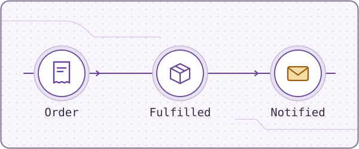</picture>
<strong>What happens after a guest checks out?</strong>

SaaS backend

I built a Go backend for two storefronts and their Telegram bots. Guests can pay on the web without creating an account and get an email telling them whether their order was fulfilled or declined. <em>The source code is private.</em>
</td><td width="50%" valign="top"><picture><source media="(prefers-color-scheme: dark)" srcset="assets/art/grader-dark.svg">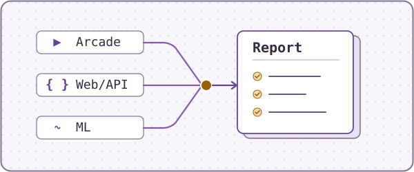</picture>
<strong>Can an autograder play a student’s game?</strong>

Yandex Contest autograder

I built a scenario-based autograder for Yandex Contest. For games written with Python’s Arcade library, it replays a player’s moves in a headless Linux container, compares the frames with a reference run and tells the student which check failed.
</td></tr>
</table>

Inside the projects

<strong>SaaS backend</strong>

Each storefront has its own Telegram bot. Customers can place an order in chat, pay with Telegram Stars and see the same order status on the website. I track wallet balances in PostgreSQL using an append-only, double-entry ledger.

<strong>What if the same payment confirmation arrives twice?</strong> My integration test sends the confirmation twice and checks that the payment is applied to the order only once. I also test concurrent debits and check successful and error responses against the OpenAPI contract. The Go test files contain just over twice as many lines as the rest of the handwritten Go code.

<strong>Yandex Contest autograder</strong>

Authors describe actions and expected results in JSON, try the scenario locally and package it for Yandex Contest. The same approach can work for other task types and languages once you define how to run the submission and what to observe.

My Web/API pilot supplies HTTP responses and checks the requests a submission sends. For ML tasks, I check how the program splits the data and trains a model. I plan to bring the Arcade runner into <a href="https://github.com/Qu1nel/PythonCodeTester">PythonCodeTester</a> first.

More projects

<table width="100%">
<tr><td width="33%" valign="top"><a href="https://github.com/Qu1nel/Cardioid"><picture><source media="(prefers-color-scheme: dark)" srcset="assets/art/cardioid-dark.svg">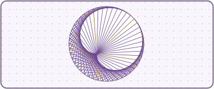</picture></a>
<strong><a href="https://github.com/Qu1nel/Cardioid">Cardioid</a></strong>

Straight lines between points on a circle trace a changing curve in Pygame.
</td><td width="33%" valign="top"><a href="https://github.com/Qu1nel/CellularAutomaton"><picture><source media="(prefers-color-scheme: dark)" srcset="assets/art/cellular-dark.svg">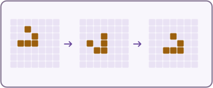</picture></a>
<strong><a href="https://github.com/Qu1nel/CellularAutomaton">Cellular Automaton</a></strong>

I built a simulator where you can choose which cells count as neighbours, set the rules for birth and survival, and watch the pattern evolve.
</td><td width="33%" valign="top"><a href="https://github.com/Qu1nel/2048"><picture><source media="(prefers-color-scheme: dark)" srcset="assets/art/2048-dark.svg">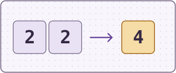</picture></a>
<strong><a href="https://github.com/Qu1nel/2048">2048</a></strong>

My first personal project, built with Pygame two and a half months after I started learning Python.
</td></tr>
<tr><td width="33%" valign="top"><a href="https://github.com/Qu1nel/Print"><picture><source media="(prefers-color-scheme: dark)" srcset="assets/art/print-dark.svg">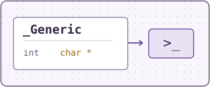</picture></a>
<strong><a href="https://github.com/Qu1nel/Print">Print in C</a></strong>

I wanted Python’s <code>print()</code> in C, so I wrote a macro that formats each argument by type.
</td><td width="33%" valign="top"><a href="https://github.com/Qu1nel/PythonCodeValidator"><picture><source media="(prefers-color-scheme: dark)" srcset="assets/art/validator-dark.svg">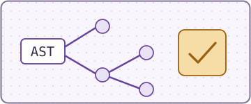</picture></a>
<strong><a href="https://github.com/Qu1nel/PythonCodeValidator">Python Code Validator</a></strong>

Course authors can check a Python submission without running it. A JSON rule can inspect the syntax tree for a <code>solve()</code> function. <a href="https://pypi.org/project/python-code-validator/">Package on PyPI</a>.
</td><td width="33%" valign="top"><a href="https://github.com/Qu1nel/Algorithms"><picture><source media="(prefers-color-scheme: dark)" srcset="assets/art/algorithms-dark.svg">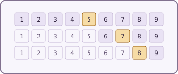</picture></a>
<strong><a href="https://github.com/Qu1nel/Algorithms">Algorithms</a></strong>

My notes on why algorithms work, what they cost and how their implementations behave.
</td></tr>
</table>

## Toolbox

<picture><source media="(prefers-color-scheme: dark)" srcset="assets/badges/badge-go-dark.svg"></picture> <picture><source media="(prefers-color-scheme: dark)" srcset="assets/badges/badge-python-dark.svg"></picture> <picture><source media="(prefers-color-scheme: dark)" srcset="assets/badges/badge-postgresql-dark.svg"></picture> <picture><source media="(prefers-color-scheme: dark)" srcset="assets/badges/badge-openapi-dark.svg"></picture> <picture><source media="(prefers-color-scheme: dark)" srcset="assets/badges/badge-docker-dark.svg"></picture> <picture><source media="(prefers-color-scheme: dark)" srcset="assets/badges/badge-linux-dark.svg"></picture> <picture><source media="(prefers-color-scheme: dark)" srcset="assets/badges/badge-github-actions-dark.svg"></picture> <picture><source media="(prefers-color-scheme: dark)" srcset="assets/badges/badge-pytest-dark.svg"></picture>

Full toolbox

<table width="100%">
<tr><td width="50%" valign="top"><picture><source media="(prefers-color-scheme: dark)" srcset="assets/toolbox/group-0-now-icons-dark.svg">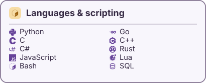</picture></td><td width="50%" valign="top"><picture><source media="(prefers-color-scheme: dark)" srcset="assets/toolbox/group-1-now-icons-dark.svg">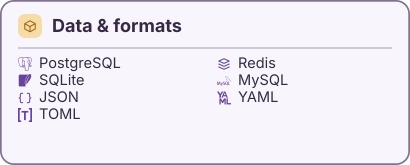</picture></td></tr>
<tr><td width="50%" valign="top"><picture><source media="(prefers-color-scheme: dark)" srcset="assets/toolbox/group-2-now-icons-dark.svg">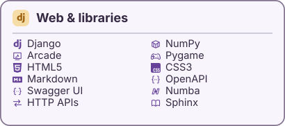</picture></td><td width="50%" valign="top"><picture><source media="(prefers-color-scheme: dark)" srcset="assets/toolbox/group-3-now-icons-dark.svg">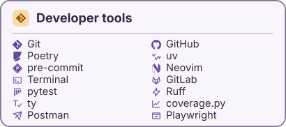</picture></td></tr>
<tr><td width="50%" valign="top"><picture><source media="(prefers-color-scheme: dark)" srcset="assets/toolbox/group-4-now-icons-dark.svg">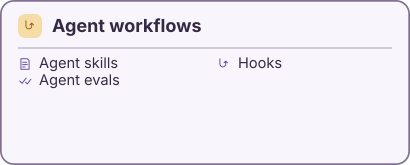</picture></td><td width="50%" valign="top"><picture><source media="(prefers-color-scheme: dark)" srcset="assets/toolbox/group-5-now-icons-dark.svg">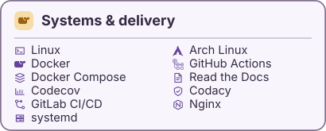</picture></td></tr>
</table>

## Activity

<picture><source media="(prefers-color-scheme: dark)" srcset="https://raw.githubusercontent.com/Qu1nel/Qu1nel/output/github-contribution-grid-snake-dark.svg"></picture>

Activity in numbers

<em>Cards refresh weekly. Dates show the last successful check.</em>
<table width="100%">
<tr><td width="50%" valign="top"><picture><source media="(prefers-color-scheme: dark)" srcset="assets/activity/wakatime-dark.svg">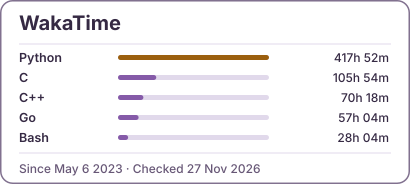</picture></td><td width="50%" valign="top"><picture><source media="(prefers-color-scheme: dark)" srcset="assets/activity/github-dark.svg">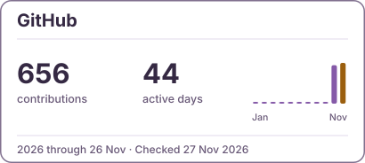</picture></td></tr>
<tr><td width="50%" valign="top"><picture><source media="(prefers-color-scheme: dark)" srcset="assets/activity/leetcode-dark.svg">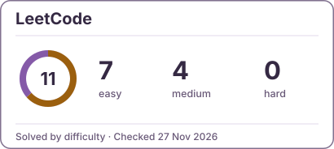</picture></td><td width="50%" valign="top"><picture><source media="(prefers-color-scheme: dark)" srcset="assets/activity/codewars-dark.svg">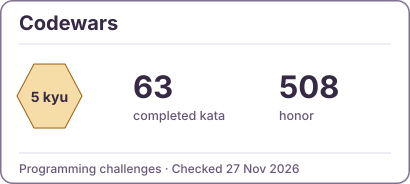</picture></td></tr>
<tr><td width="50%" valign="top"><picture><source media="(prefers-color-scheme: dark)" srcset="assets/activity/euler-dark.svg">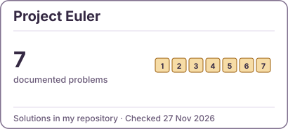</picture></td><td width="50%" valign="top"><picture><source media="(prefers-color-scheme: dark)" srcset="assets/activity/pypi-dark.svg">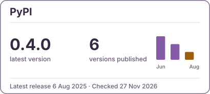</picture></td></tr>
</table>

<a href="https://wakatime.com/@Qu1nel"><picture><source media="(prefers-color-scheme: dark)" srcset="assets/badges/button-wakatime-dark.svg"></picture></a> <a href="https://www.codewars.com/users/Qu1nel"><picture><source media="(prefers-color-scheme: dark)" srcset="assets/badges/button-codewars-dark.svg"></picture></a> <a href="https://leetcode.com/u/Qu1nel/"><picture><source media="(prefers-color-scheme: dark)" srcset="assets/badges/button-leetcode-dark.svg"></picture></a> <a href="https://github.com/Qu1nel"><picture><source media="(prefers-color-scheme: dark)" srcset="assets/badges/button-github-dark.svg"></picture></a> <a href="https://pypi.org/project/python-code-validator/"><picture><source media="(prefers-color-scheme: dark)" srcset="assets/badges/button-pypi-dark.svg"></picture></a> <a href="https://github.com/Qu1nel/ProjectEuler#problems"><picture><source media="(prefers-color-scheme: dark)" srcset="assets/badges/button-project-euler-dark.svg"></picture></a>

## Elsewhere

<picture><source media="(prefers-color-scheme: dark)" srcset="assets/art/crow-dark.svg">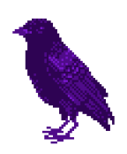</picture> <a href="mailto:covach.qn@gmail.com"><picture><source media="(prefers-color-scheme: dark)" srcset="assets/badges/button-email-dark.svg"></picture></a> <a href="https://t.me/qnllnq"><picture><source media="(prefers-color-scheme: dark)" srcset="assets/badges/button-telegram-dark.svg"></picture></a>

 <a href="https://komarev.com/ghpvc/?username=Qu1nel&amp;label=Profile%20views&amp;color=75519a&amp;style=flat"><picture><source media="(prefers-color-scheme: dark)" srcset="https://komarev.com/ghpvc/?username=Qu1nel&amp;label=Profile%20views&amp;style=flat&amp;color=7B4C40"></picture></a>

